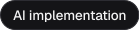

<picture>
  <source media="(prefers-color-scheme: dark)" srcset="./assets/banner-dark.svg">
  
</picture>

I build the layer between messy systems and real users: APIs, data pipelines and applied AI,
designed so non-technical teams actually adopt them. If a workflow is slow, manual or
repetitive, I'm usually already working out how software can take it off people's hands.

   

## &nbsp; Start here

**[QuantTrader architecture](https://github.com/nomaan02/quanttrader-architecture)** 
Real-time market data and a local LLM layer that analyses but never executes 
     

**[Everlink](https://github.com/nomaan02/everlink-nfc-commerce)** 
Shopify webhooks → NFC-linked personalised pages 
    

**[Canvasser Performance Platform](https://github.com/nomaan02/canvasser-performance-platform)** 
Field-sales dashboards from a CRM and UK open data 
    

## &nbsp; What I'm good at

- **Integrations:** REST APIs and webhooks (Shopify Admin/Storefront, CRMs)
- **Data & infra:** pipelines, record matching (UPRN), Redis, Docker
- **Applied AI:** local LLMs (Ollama), RAG, MCP, context engineering
- **Build:** Python, TypeScript, Next.js, React
- **People:** Figma-to-code handover, explaining technical things to non-technical people

<picture>
  <source media="(prefers-color-scheme: dark)" srcset="https://skillicons.dev/icons?i=python%2Cts%2Cnextjs%2Creact%2Cdocker%2Credis%2Cfigma%2Cblender&theme=dark">
  
</picture>

## &nbsp; How I use AI

AI is only as good as the context it's given, so I engineer the context first. Each project I
work on has its own knowledge base, or "brain": architecture notes, decision records and
session logs that the model can pull from and fall back on.

I try to do the context-heavy groundwork before a task reaches the model, so it can spend its
effort on solving the problem rather than piecing the problem together.

I use Claude Code and Cursor daily, but I still design the architecture myself, review every
diff and test what ships.

    

<b>My AI workflow in a bit more detail</b>

 

- **I don't re-explain projects from scratch.** The knowledge base (specs, decision records,
  implementation plans and session logs) is something the model reads from and writes back to,
  so every session starts with the full picture.
- **I organise context so it's easy to retrieve.** Notes are structured and labelled so the
  model can pull in the part that's relevant, rather than everything at once. On one project
  this meant connecting an Obsidian vault to the model through an MCP server.
- **I log changes as I go.** Decisions, updates and lessons learned get written back into the
  knowledge base, so the project's memory builds up over time instead of going stale.
- **I rely on guardrails rather than trust.** Project rules, hooks and automations enforce
  conventions, block risky actions and catch mistakes before they make it into the codebase.
- **I prepare tasks before handing them over.** Simple but context-heavy work, like gathering
  the right files, summarising logs or shaping inputs, is done first, so the model can focus
  on getting the actual solution right.
- **I stay in charge of the decisions.** I own the architecture, review every change and verify
  it with tests. AI speeds the work up, but it doesn't make the calls.

## &nbsp; Get in touch

Open to these roles:

   

 
